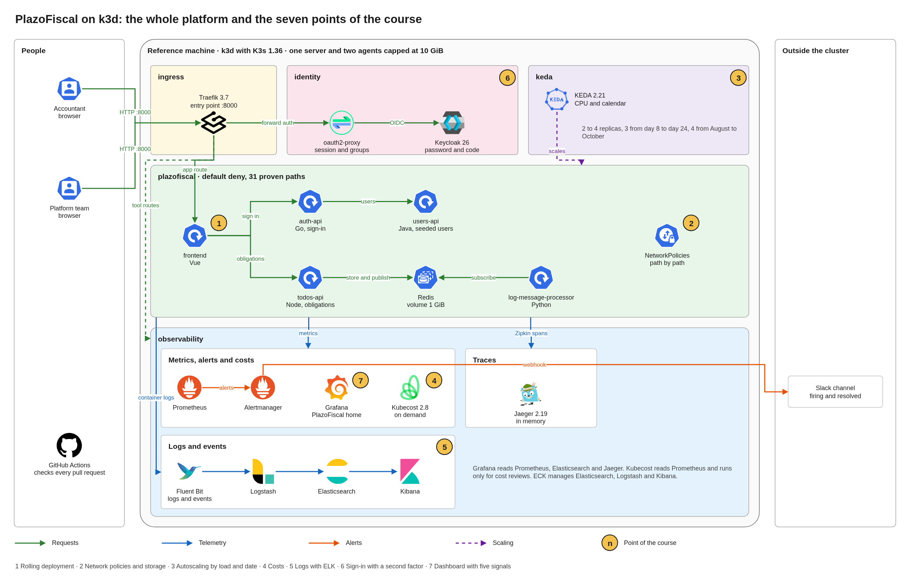
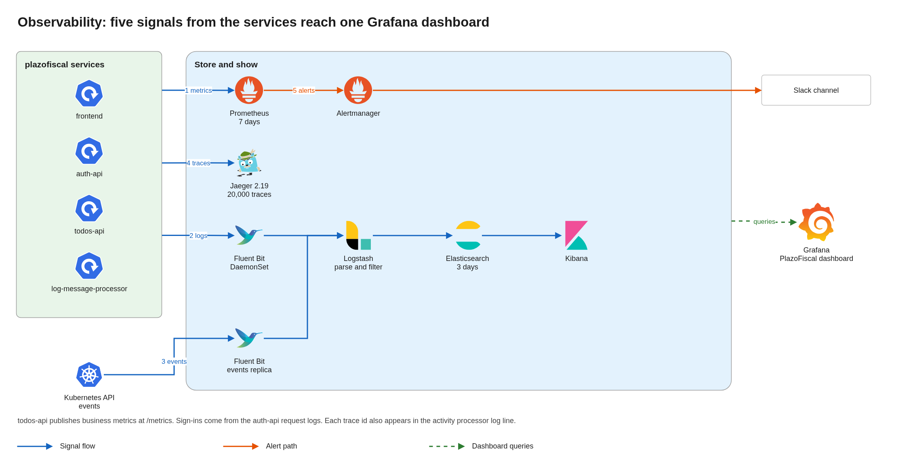
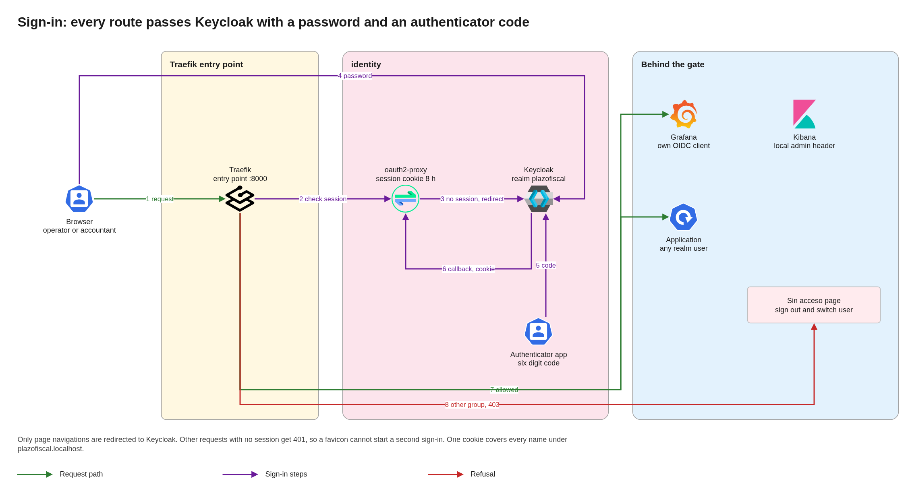

# Architecture

This document explains how PlazoFiscal runs on a local Kubernetes cluster of three nodes, why the cluster has its size, and how the main decisions fit the capacity available. The business reasons live in the [business case](business-case.md).

## Contents

1. Terms
2. Overview
3. Capacity
4. Rolling deployment
5. Storage
6. Network isolation
7. Autoscaling
8. Observability
9. Entry point and sign-in
10. Decisions and alternatives
11. Assumptions and pending confirmations

## 1. Terms

| Term | Meaning |
|---|---|
| K3s | A lightweight Kubernetes distribution |
| k3d | A tool that runs each K3s node as a Docker container |
| Rolling update | A release that replaces pods a few at a time |
| PVC | A request for a persistent disk |
| HPA | The Kubernetes object that changes replicas by load |
| OIDC | A sign-in standard, used here for people |

## 2. Overview

One K3s cluster holds the application and the operations tools. k3d runs its three nodes as Docker containers on one machine, with one server that runs the control plane and workloads, and two agents that run workloads. K3s enforces network policies with its embedded controller. The Traefik and load balancer bundled with K3s are disabled, so the platform installs its own Traefik in the `ingress` namespace. Traefik receives traffic, and sign-in protects each entry point. The platform has no cloud dependency, so any machine with enough memory can run it from a clean clone.

| Namespace | Holds |
|---|---|
| `plazofiscal` | Application and Redis |
| `ingress` | Traefik |
| `identity` | Keycloak and oauth2-proxy |
| `observability` | Prometheus, Alertmanager, Grafana, Jaeger, ELK and Kubecost |
| `keda` | Scaling by date and load |

The numbers mark the points of the course. 1 is the rolling deployment of the services, 2 the network policies and the Redis volume, 3 scaling by load and calendar, 4 costs, 5 logs with ELK, 6 sign-in with a second factor, and 7 the dashboard with the five signals. Green arrows are requests, blue arrows telemetry, orange arrows alerts and the dashed purple arrow scaling.

## 3. Capacity

Memory limits the design more than any other factor. The reference machine has 8 cores and 13.5 GiB. k3d caps the server node at 3 GiB and each agent at 3.5 GiB, 10 GiB in total, and leaves the rest to the operating system. The nodes share the CPU with no cap. Each tool runs one replica with reduced memory.

| Component | Memory | Origin |
|---|---|---|
| Kubernetes on three nodes and metrics server | 0.8 GiB | Measured |
| Elasticsearch | 1.0 GiB | Measured |
| Logstash and Kibana | 1.6 GiB | Measured, Kibana 1.0 and Logstash 0.6 |
| Prometheus, Alertmanager, Grafana and exporters | 1.0 GiB | Measured |
| Kubecost | 0.75 GiB | Measured, started only for cost reviews |
| Jaeger and Fluent Bit | 0.05 GiB | Measured |
| Keycloak and oauth2-proxy | 0.6 GiB | Measured |
| Traefik and KEDA | 0.3 GiB | Measured, Traefik 0.1 and KEDA 0.2 |
| Application at maximum replicas | 1.1 GiB | Measured with the users service capped |
| **Total, with Kubecost on** | **7.2 GiB** | |

Measured rows come from `kubectl top` on the reference machine with the application running. Grafana takes about 0.4 GiB and Prometheus about 0.5 GiB, which grows with the data it keeps. Kibana 9.5 needs a Node heap of 1 GiB, because it runs its migrations again on every start and fails with less.

With every tool but Kubecost running, the nodes use about 7.2 GiB of their 10 GiB. The machine is the tighter limit, since its desktop takes about 3.8 GiB of the 13.5. When the stack and the desktop together leave under 2 GiB free, the machine swaps, and under that pressure the server node restarted its components twice, recovering by itself within minutes. Three measures keep the platform inside the machine. Kubecost runs only for cost reviews, through `make costs-on`. Elasticsearch, Keycloak and Grafana run on the agents, which leaves the server node for the control plane, Kibana and light pods. The users service caps its Java heap at 192 MiB, since Java 8 otherwise sizes it from the node and held 1.0 GiB, and it now takes about 0.27 GiB. Close heavy programs and virtual machines before a demonstration, and stop the cluster when it is not in use.

The cluster runs three nodes, so a rolling update, a disruption budget and the spread of replicas have a real effect. More nodes would repeat the per node overhead with no gain for the demonstration. A production service would run its nodes across zones, on separate machines.

## 4. Rolling deployment

Each service sets `maxSurge: 1` and `maxUnavailable: 0`. Kubernetes starts one new pod, waits for its readiness probe, and only then removes an old one, so capacity never falls during a release. A PodDisruptionBudget declares the same limit for planned disruptions, so draining one of the three nodes moves pods one at a time. An undo returns to the previous version with the same mechanism.

The frontend, the sign-in service and the obligations service run two replicas each, spread over different nodes, so one pod keeps serving while the other is replaced and the loss of a node does not stop the service. The users service runs one replica, since its database is seeded inside each pod.

Removing an old pod follows three steps, so no request in flight is lost.

| Step | What happens | Why |
|---|---|---|
| 1 | The pod leaves the endpoints of its service, and a `preStop` hook waits 5 seconds | Every node stops routing new connections to it before it stops |
| 2 | The process receives SIGTERM, stops accepting connections and finishes open requests | Requests already received get their answer |
| 3 | The frontend answers with `Connection: close` while it shuts down, and the process exits when its connections end, or after 15 seconds | Clients that keep connections open reconnect to another pod |

Before this sequence existed, the services ignored SIGTERM, each old pod lived for the full grace period of 30 seconds, and a release of the frontend under load failed 6 of 4151 requests. With it, a pod stops in about one second, and releasing each of the four services under load failed none.

A release is proven with `make load`, which runs accountant traffic inside the cluster while `make rollout` replaces a service. The load signs in, lists obligations and creates and closes them at 15 requests per second, the rate of the monthly filing window, and it fails if a single request fails.

The extra pod needs room in the cluster, so a release and a scaling event compete for the same capacity. Replica limits leave space for that.

Redis stays outside this strategy. It runs one replica with a persistent disk, so a new version replaces it with a short interruption.

## 5. Storage

Redis persists its data with an append-only file on a persistent volume, and the activity processor keeps its log on another. K3s provides those volumes through its local path provisioner, from a folder of the node where the pod first ran. The volume stays on that node, so Redis and the activity processor always return to it, and they wait if that node is down. Data survives pod restarts and `make stop`, and `make down` erases it. A production service would use managed disks and backups.

The obligations service keeps nothing in its own memory. Each user has a hash in Redis with one field per obligation, and a counter that hands out ids. Those Redis operations are atomic, so any number of replicas share the same data, and a rolling update or a restart loses nothing. The service reports ready only while Redis answers, so a pod that cannot reach it leaves the service without being restarted.

Persistence was proven on the three node cluster. Obligations created through the API remained identical after the Redis pod was deleted, the pod returned in 12 seconds to the node that holds its volume, and the activity log kept its lines through a restart of the processor and grew afterward.

Redis runs one replica, so its restart interrupts the service. While it is down, the Redis client of the obligations service holds new commands and sends them once Redis is back, so requests wait instead of failing. Redis is checked for readiness every two seconds to keep that wait short. With accountant traffic at 15 requests per second, deleting the Redis pod delayed requests by up to 4.1 seconds and failed 1 of 2031, the request in flight when the connection dropped, which received a 503 answer. A production service would run Redis with a replica and automatic failover.

## 6. Network isolation

The `plazofiscal` namespace starts from default deny, for traffic in both directions. Each policy then opens one path, and the policy controller embedded in K3s enforces them. A new pod can be refused for a few seconds until the controller registers it, so the services retry their first connection to Redis. No service reaches another unless a policy names that path. No service exposes metrics yet, so the observability namespace has no path into the application, and Prometheus reads container and replica figures from the kubelet and kube-state-metrics.

| From | To | Port |
|---|---|---|
| Traefik | Frontend | 8080 |
| Frontend | Sign-in service and obligations service | 8081, 8082 |
| Sign-in service | Users service | 8083 |
| Obligations service and activity processor | Redis | 6379 |
| Load test, only while `make load` runs | Frontend | 8080 |
| Each pod | Trace collector | 9411 |
| Prometheus | Obligations service, for `/metrics` | 8082 |

`make check-policies` proves the table. It opens a connection along every allowed path from the real pods, since a probe pod that carried an application label would join that service and receive real traffic. It then tries the paths the policies leave closed, between services, from an unlabeled pod, from another namespace, from the `ingress` namespace toward anything but the frontend, from an unlabeled pod of the `observability` namespace toward the services, and from the services toward the internet and the Kubernetes API. A refused connection looks the same whether a policy rejects it or nothing listens on the port, so every denied path targets a port that an allowed path reaches in the same run, and two control paths show that the internet and the Kubernetes API answer a pod in a namespace with no policies. The script lists each of its 31 paths with the expected and the actual result and fails on any difference. When one policy was removed on purpose, it reported exactly the two paths that policy opened.

## 7. Autoscaling

KEDA creates one HPA for each of the frontend, the sign-in service and the obligations service. Each HPA combines CPU load at 65 percent of the requested CPU with two calendar windows in the America/Bogota time zone, and it follows the trigger that asks for more replicas. The users service stays at one replica, because it uses a seeded database inside each pod, and the activity processor stays at one, because it writes to a single disk.

| Period | Replicas of each scaled service |
|---|---|
| Any time | 2, the minimum |
| Monthly filing window, 07:00 on day 8 to 20:00 on day 24 | 3 |
| Income tax season, 07:00 on 1 August to 20:00 on 31 October | 4 |
| CPU above 65 percent in any period | Up to 4, the maximum |

The calendar raises capacity before a known peak, and CPU covers what the calendar cannot predict. After a window closes or the load falls, KEDA and the HPA wait 5 minutes before removing a replica, so a short dip in traffic does not remove capacity that comes back a minute later.

Both triggers were proven on the three node cluster. Under accountant traffic at about 70 requests per second, the frontend and the obligations service went from 2 to 4 replicas within a minute and the sign-in service within three minutes, with no failed request, and all three returned to 2 about seven minutes after the traffic stopped. A calendar window moved to the next minutes raised the obligations service from 2 to 3 replicas as it opened and returned it to 2 five minutes after it closed. At 92 requests per second, with every scaled service at 4 replicas, no pod waited for room, the nodes used about 2.8 GiB together, and the memory requested by the pods stayed between 13 and 30 percent of each node.

The HPA measures CPU against the CPU each pod requests, so a request below the real idle use keeps a service at its maximum. The sign-in service requests 50 millicores, close to the 40 millicores per pod measured under load, and uses about 3 millicores at rest.

The rules are KEDA ScaledObjects, one short declarative object per service. A scheduled job that edited the HPA would need permissions to change cluster objects and would duplicate the logic of the HPA. The Deployments of the scaled services declare no replica count, so applying them never fights the HPA.

## 8. Observability

The `observability` namespace holds the tools that watch the platform. The business dashboard joins the five signals with the business indicators.

| Signal | Source | Storage |
|---|---|---|
| Metrics | Prometheus | Prometheus |
| Logs | Fluent Bit on each node, processed by Logstash | Elasticsearch, read in Kibana |
| Traces | Services in Zipkin format, received by Jaeger | Jaeger, in memory |
| Events | Fluent Bit reading the Kubernetes API, processed by Logstash | Elasticsearch, read in Kibana |
| Alerts | Prometheus rules | Alertmanager, which posts to Slack |

### Metrics

The kube-prometheus-stack chart installs the Prometheus operator, Prometheus, Alertmanager, Grafana, kube-state-metrics and node exporter. Prometheus reads the kubelet and its container metrics, the Kubernetes API, CoreDNS, kube-state-metrics, node exporter, KEDA and Kubecost. It keeps 7 days on a 4 GiB volume, capped at 3 GB, which covers a week of cost history. K3s runs the controller manager, the scheduler, etcd and kube-proxy inside one process with no separate metrics endpoints, so their scrapes, rules and dashboards are off.

Each k3d node is a container on the same machine. Node exporter therefore reports the CPU, disks and network of the whole machine three times, and k3d replaces the memory file of each node to cap it, which leaves node exporter with no memory figures. The memory of each node comes from the kubelet, in the Nodes Overview and Node dashboards.

### Dashboards

Grafana loads its dashboards from ConfigMaps, so each one lives in the repository.

| Layer | Dashboards |
|---|---|
| Machine | Node Exporter Nodes and USE Method, for CPU, load, disks and network |
| Cluster | Compute Resources for the cluster, the nodes, each namespace, workload and pod, and Persistent Volumes |
| Application network | Networking by namespace, workload and pod, with bytes and packets |
| Autoscaling | KEDA, with the replicas of each scaled service against its maximum over time |
| Alerts | Alertmanager Overview, and the alert rules in Grafana Alerting |
| Platform | Prometheus, Grafana, kubelet, CoreDNS and the Kubernetes API |
| Costs | The Kubecost interface |
| Business | PlazoFiscal, the home dashboard |

### Business dashboard

The PlazoFiscal dashboard opens first in Grafana and joins the five signals with the indicators of the business case.

| Row | Panels | Source |
|---|---|---|
| Business | Obligations registered in the last 24 hours and by tax, obligations overdue and due in the next 7 days, sign-ins by result, and whether a filing window is open | Metrics of the obligations service, sign-in logs in Elasticsearch, and KEDA |
| Service health | Requests at the entry point by status, requests and p95 latency of the obligations service, replicas against the maximum, CPU by service | Traefik, the obligations service, kube-state-metrics and the kubelet |
| Alerts | Alerts firing or pending, except the always-on `Watchdog` | Prometheus |
| Logs | Service logs | Elasticsearch |
| Traces | Recent traces of obligations and of sign-ins, each one opening inside Grafana | Jaeger |
| Kubernetes events | Scaling, rollouts and failed probes | Elasticsearch |

The obligations service publishes its metrics at `/metrics`. A counter tracks obligations registered by tax, a histogram tracks the duration of each request by route and status, and a gauge counts the stored obligations by due status and tax, read from Redis each time Prometheus scrapes, which suits the size of the pilot. Every replica reports the same gauge, so the dashboard takes the maximum. Sign-ins come from the request logs of the sign-in service, which Logstash already parses, so that service needs no change. A network policy admits only the Prometheus pods into the obligations service, on its own port.

### Alerts

The chart brings the community rules for Kubernetes, such as a pod that restarts in a loop or an HPA that stays at its maximum for 15 minutes. That second rule covers the capacity of the filing calendar. PlazoFiscal adds one rule of its own.

| Alert | Severity | Fires when |
|---|---|---|
| `PlazoFiscalServiceDown` | Critical | A Deployment or StatefulSet of `plazofiscal` has no ready replica for 1 minute |

Alertmanager groups alerts by name and namespace and posts each group to a Slack channel, firing and resolved. The webhook address is a credential, so it lives in a file outside the repository that the installation turns into a Secret. Without that file, alerts stay visible in Alertmanager and Grafana and leave the cluster through no channel. `Watchdog`, which always fires to prove the pipeline is alive, and the inhibition helper never reach Slack.

The path was proven end to end. With the users service scaled to zero, the rule went pending after about 40 seconds, fired one minute later and reached Slack within the next 40 seconds. After the restore, the resolved message reached Slack about five minutes later, at the next group interval.

### Logs and events

Elasticsearch, Logstash and Kibana 9.5 run through the ECK operator, which manages their certificates, users and upgrades. Fluent Bit runs on each node and tails the container logs of `plazofiscal`, adds the pod, namespace and labels of each line, and sends batches to Logstash. A second Fluent Bit replica reads Kubernetes events from the API server and sends them the same way. Logstash names the service of each line from its `app` label, reads the log level, keeps the JSON fields of a service under `app`, and drops the readiness and liveness probes, which hit every pod every few seconds and say nothing about accountants. Logs land in the data stream `logs-plazofiscal-default` and events in `logs-kubernetes.events-default`, and Kibana opens both through two data views.

Elasticsearch runs one node on an agent, with a 512 MiB heap and a 5 GiB volume. Each index has no replica, since there is no second node to hold it, and a lifecycle policy rolls indices daily and deletes them after 3 days. The nodes of k3d cannot raise the kernel limit on memory maps, so Elasticsearch reads its files without them. Fluent Bit polls log files, because the nodes share the inotify limit of the machine, which other programs on a desktop exhaust.

Fluent Bit replaces two tools, a log shipper and a dedicated event exporter. The usual event exporter for Kubernetes has had no release since early 2024, and Fluent Bit covers both signals at about 20 MiB per pod.

### Traces

Every service reports spans in Zipkin format. The frontend reports the browser side of each call through its development server, the sign-in, obligations and users services report their HTTP calls, and the activity processor continues the trace of the obligation that produced its message, since the obligations service puts the trace id in the message it publishes to Redis. Jaeger 2.19 receives Zipkin on port 9411 and OTLP on 4317 and 4318, and keeps the last 20,000 traces in memory. A restart of Jaeger clears them, which suits a demonstration and adds no load to Elasticsearch.

One request can be followed across the platform. Signing in gives one trace through the frontend, the sign-in service and the users service. Creating an obligation gives one trace through the frontend, the obligations service and the activity processor, and the line the processor logs carries the same trace id, so the trace in Jaeger leads to the logs in Kibana.

### Costs

Kubecost reads the same Prometheus, so the cluster runs one metrics server. Version 2.8 is the last line of Kubecost built on Prometheus. Version 3 replaced Prometheus with its own agent and a ClickHouse database, its chart requests 3 GiB for the aggregator alone, and its authors recommend 8 GB for it, which does not fit a node of 3.5 GiB. Kubecost 2.8 runs as one pod with its cost model, aggregator and interface, at about 0.5 GiB, and its forecasting, network costs and bundled Grafana are off.

## 9. Entry point and sign-in

Traefik is the single entry point. k3d maps port 8000 of the machine to a node port of Traefik, and every tool and the application have a name under `plazofiscal.localhost`, which browsers and the machine resolve to itself. Inside the cluster, CoreDNS rewrites the same names to the Traefik Service, which also listens on port 8000, so the address of Keycloak is the same for a browser and for a pod. Grafana and oauth2-proxy can then validate the tokens Keycloak issues to browsers.

| Name | Serves | Who reaches it |
|---|---|---|
| `app.plazofiscal.localhost:8000` | The application | Any user of the realm |
| `grafana`, `kibana`, `kubecost`, `jaeger`, `alertmanager`, `prometheus` | The operations tools | The group `plataforma` |
| `auth.plazofiscal.localhost:8000` | Keycloak | Everyone, since it is the sign-in page |

Keycloak holds the realm `plazofiscal`, imported from a file in the repository on its first start, with the groups `plataforma` and `contadores`. Every user must enrol an authenticator app on the first sign-in, and from then on each sign-in asks for the password and a six digit code that changes every 30 seconds. Keycloak keeps its data on a volume, so enrolled authenticators survive a restart. It runs one pod with its file database, which suits one instance and avoids a separate database server.

The numbered steps follow one request. The browser asks Traefik for a tool (1), and Traefik asks oauth2-proxy whether the request carries a session (2). With no session, oauth2-proxy sends the browser to Keycloak (3), which asks for the password (4) and the code of the authenticator app (5), then returns to oauth2-proxy, which sets the session cookie (6). From then on Traefik lets the request through (7), or shows the refusal page when the user is outside the group of the tool (8).

Every route passes `oauth2-proxy` before reaching its service. Traefik asks oauth2-proxy whether the request carries a valid session, and the tools also require the group `plataforma`. A user outside that group gets a page in Spanish that explains it and offers to sign out and sign in as someone else. A request with no session receives the sign-in page of oauth2-proxy, which sends the browser to Keycloak and back to the address it asked for. The session cookie covers every name under `plazofiscal.localhost`, so one sign-in opens all the tools for 8 hours. Only page navigations are sent to Keycloak. Other requests with no session, such as the favicon a browser asks for while the sign-in page is open, get a plain refusal, since each redirect would start a second sign-in and void the first. Each sign-in also keeps its own protection cookie, so two tabs can sign in at once.

Behind that gate, Grafana signs people in again through its own OIDC client, with no extra form since Keycloak already has a session, and gives the group `plataforma` the Admin role. Signing out of Grafana ends the session of the entry point and then the Keycloak session, so the next visit asks for the password and code again. Kibana has no single sign-on on its free license, so the entry point passes its local admin after Keycloak has accepted the second factor. The application keeps its own sign-in after the gate, so an accountant signs in twice, once with the second factor and once in the application.

The machine serves plain HTTP on port 8000. Keycloak accepts it from the machine and from private addresses, and the session cookie is not marked secure. A deployment reachable from a network would serve TLS at the same entry point and mark the cookie secure.

## 10. Decisions and alternatives

| Decision | Alternative | Why this one |
|---|---|---|
| K3s on three nodes through k3d | A managed cloud cluster, minikube on one node, or kind with Cilium | It costs nothing, anyone with Docker can run it, three nodes give rollouts and disruption budgets a real effect, and k3d caps the memory of each node |
| The policy controller of K3s | Cilium | It enforces network policies with no extra agent on each node |
| Traefik | `ingress-nginx` | `ingress-nginx` is retired and receives no fixes |
| Names under `plazofiscal.localhost` on port 8000 | A port forward per tool, or TLS with a self-signed certificate | Nothing has to keep running, and no certificate has to be trusted on each machine |
| oauth2-proxy in front of the application | Single sign-on inside the application | The application stays unchanged, at the cost of a second sign-in |
| Keycloak with its file database | Keycloak with PostgreSQL through its operator | One instance needs no database server, which saves memory |
| Keycloak | An external identity provider | It works with no outside dependency, at about 0.6 GiB |
| Calendar rules through KEDA | A scheduled job that edits the HPA | One declarative object, with no extra permissions |
| Kubecost 2.8 on the platform Prometheus | Kubecost 3, or OpenCost | Kubecost 3 needs more memory than a node has, and OpenCost lacks the Kubecost interface |
| Alerts to Slack | A mail catcher inside the cluster, or Discord | Alerts reach a channel people read on their phones, and Alertmanager supports Slack natively |
| ECK for Elasticsearch, Logstash and Kibana | The archived Elastic Helm charts, or plain manifests | The operator handles certificates, users and upgrades, and its charts are current |
| Fluent Bit for logs and events | Filebeat with a separate event exporter | One small tool covers both signals, and the usual event exporter is unmaintained |
| Logstash in the log path | Fluent Bit straight to Elasticsearch | Parsing and filtering live in one place, at about 0.75 GiB |
| Jaeger 2.19 | Jaeger 2.22 | Jaeger 2.20 removed the query endpoints that the Grafana Jaeger data source calls, so 2.19 keeps traces inside the dashboard |
| Jaeger with memory storage | Jaeger on Elasticsearch | Traces of a demonstration need no history, and Elasticsearch keeps its memory for logs |
| One public repository | Several repositories | One change can touch code, manifests and documents |

## 11. Assumptions and pending confirmations

| Item | Who confirms | Effect if it fails |
|---|---|---|
| The machine keeps about 3 GiB free beside the cluster during a demonstration | Each demonstration | Close programs. If that is not enough, remove Logstash from the path and keep Elasticsearch and Kibana |
| Kubecost 2.8 keeps working on Kubernetes 1.36 | Each upgrade of K3s | Move to OpenCost, its open source base, on the same Prometheus |

## Prices in Kubecost

A local cluster has no bill, so Kubecost estimates from its default reference prices. Its figures show how cost would divide across services, and they describe no real invoice. The free tier covers up to 250 cores and keeps 15 days of metrics, which fits this cluster. Custom prices belong to its paid tier.
